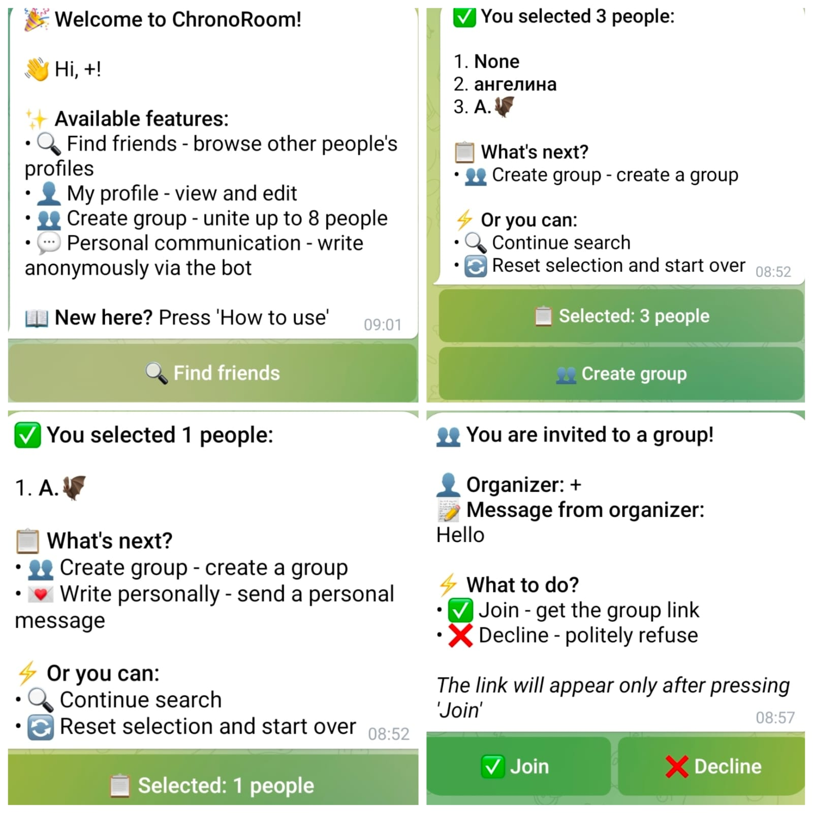

# ChronoRoom — Profile Board Telegram Bot

A Telegram bot for discovering people through profiles, starting anonymous conversations, and creating group chats around shared interests.

## 📸 Demo



## ✨ Features

- 🌍 Browse user profiles (shuffled for every new search, paginated)
- 👤 Personal profiles with a short bio
- 💬 Anonymous communication through the bot (the recipient never sees your username)
- 📨 Personal message requests with a "Reply" button
- 👥 Select multiple users
- 🏠 Create group chats
- 🔗 Telegram group invitations
- ✅ Accept or decline invitations (each invitee can answer once)
- 📝 Optional messages for group invitations
- 🔐 Telegram channel subscription check (optional)
- 💾 Persistent data storage (SQLite)

## 🔄 How It Works

1. The user opens the profile board.
2. Available profiles are displayed.
3. The user can select a person to communicate with.
4. For multiple selected users, the bot can create a group invitation.
5. The organizer provides the Telegram group link.
6. Selected users receive an invitation.
7. Users can accept or decline the invitation.
8. Users who accept receive the group link, and the organizer is notified.

## 👥 Group Invitations

The bot allows users to:

- select several profiles;
- create a group;
- provide a Telegram invite link;
- add an optional message;
- send invitations to selected users;
- process accept/decline responses.

Only people whose channel subscription is confirmed are invited. The organizer gets a report with the number of people invited, the number who could not be invited, and the number whose subscription could not be verified because Telegram did not answer.

## 🔐 Subscription Check

If `CHANNEL_USERNAME` is set, users must be subscribed to that channel to use the bot.

- The check **fails closed**: if Telegram cannot confirm the membership (outage, timeout, wrong settings), access is not granted. The user is told it is a temporary problem and is asked to try again; they are **not** told that they are not subscribed.
- The same rule applies when sending group invitations and personal messages: nothing is sent to a person whose subscription could not be confirmed.
- On startup the bot checks that it can read the members of the channel. If the channel is wrong or the bot is not an administrator there, it stops with an explanatory message instead of silently locking everybody out.
- Set `CHANNEL_USERNAME` to an empty value to switch the requirement off.

## 🕶 Privacy

- Usernames are never shown to other users; others see only the first name from the profile and the bio.
- Button data (`callback_data`) is readable by any Telegram client, so it contains no Telegram user ids: the board uses positions in the user's own shuffled list, and chats use random ids.
- All user-provided text (names, bios, messages) is HTML-escaped before it is sent.
- Deleting a profile also deletes the chats, the group invitations (link and message) created by that user and their answers.

## 🧩 Project Structure

```text
ChronoRoom-Bot4/
├── README.md
├── .env.example
├── .gitignore
├── requirements.txt
├── screenshots/
│   └── demo.jpg
├── tests/
│   ├── helpers.py
│   ├── test_database.py
│   ├── test_handlers.py
│   └── test_subscription.py
├── chronoroom_final.py
└── database.py
```

| File | Purpose |
| --- | --- |
| `chronoroom_final.py` | Bot entry point: handlers, keyboards, subscription check |
| `database.py` | SQLite storage (profiles, group invitations, chats) |
| `tests/` | Unit tests (standard library `unittest`) |

## 🛠 Tech Stack

- Python 3.10+
- python-telegram-bot 21+
- SQLite

## 📦 Installation

```bash
git clone <repository-url>
cd ChronoRoom-Bot4
python -m venv .venv
source .venv/bin/activate        # Windows: .venv\Scripts\activate
pip install -r requirements.txt
```

## ⚙️ Configuration

Settings are read from environment variables or from a local `.env` file (git-ignored). Copy the template and fill it in:

```bash
cp .env.example .env
```

| Variable | Required | Description |
| --- | --- | --- |
| `BOT_TOKEN` | yes | Bot token from [@BotFather](https://t.me/BotFather). It can also be placed alone in a `token.txt` file. |
| `CHANNEL_USERNAME` | no | Channel users must subscribe to (for example `@YourChannel`); the bot must be its administrator. Empty value disables the requirement. Default: `@ChronoRoom`. |
| `DATABASE_FILE` | no | SQLite file. Default: `chronoroom.db`. |
| `ADMIN_IDS` | no | Comma-separated Telegram ids allowed to use `/admin`, which starts a group invitation for a random set of profiles. |

Limits (bio length, profiles per page, maximum group size) are constants at the top of `chronoroom_final.py`.

## 🚀 Running the Bot

```bash
python chronoroom_final.py
```

## ✅ Tests

```bash
python -m unittest discover -s tests -v
```

Database tests run anywhere. The handler and subscription tests need `python-telegram-bot` (they use fake objects and no network) and are skipped automatically if it is not installed.

## 📌 About

ChronoRoom-Bot4 is one of several independent Telegram bots created for the ChronoRoom project.
